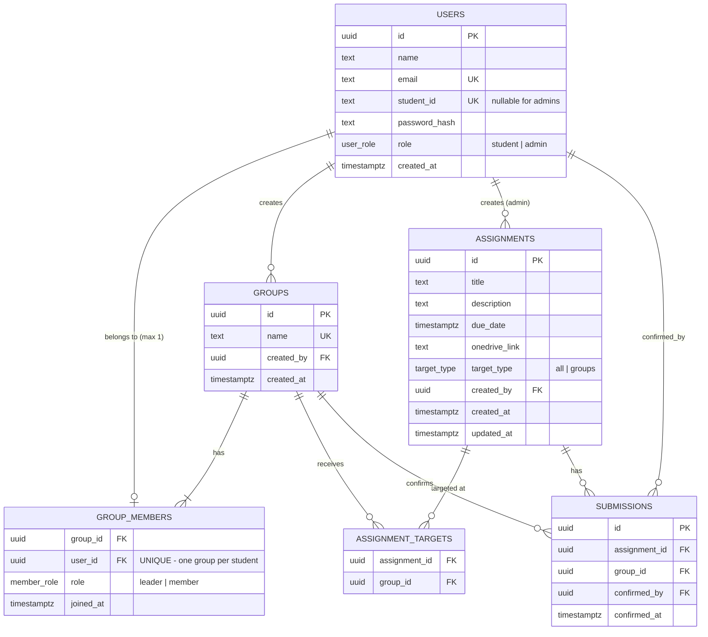

# Project Plan — Student, Group & Assignment Management System

**Company:** Joineazy · **Role:** Full Stack Intern · **Task:** 1
**Deadline:** Tuesday, 24 Nov 2026, 10:30 AM
**Stack:** React (Vite) + Tailwind CSS · Node.js + Express · Supabase (PostgreSQL) · JWT auth · Deployed on Vercel + Render

---

## 1. Goal in one paragraph

A role-based web app where **students** register, form a group, add members, see assignments posted by professors, open the OneDrive submission link, and confirm submission through a two-step confirmation. **Admins (professors)** create/edit assignments, target them at all students or specific groups, and watch group-wise and student-wise submission progress on a dashboard with basic analytics.

---

## 2. Key design decisions (decide once, don't revisit)

| Topic | Decision | Why |
|---|---|---|
| Database | Supabase (PostgreSQL) accessed from Express via the **`@supabase/supabase-js` client** with the service role key (query builder, no raw SQL in app code). RLS is enabled on every table with no policies, so only our API can reach the data | Modern, readable queries; the key stays server-side. supabase-js can't run DDL, so the schema is created by code-based migrations (`node-pg-migrate`, written in JS, tracked in a `pgmigrations` table, run with `npm run migrate` using a `DATABASE_URL` that is used for migrations only) |
| Multi-step writes | supabase-js has no transactions, so multi-step writes (create group + leader, assignment + targets) insert in order and delete the parent row if a later step fails | Keeps the code simple; a Postgres function (`rpc`) is the upgrade path if atomicity is ever needed |
| Auth | **Custom JWT** issued by Express (`jsonwebtoken` + `bcrypt`), *not* Supabase Auth | Brief asks for JWT-based role auth; we control the payload `{ id, role }` |
| Token transport | `Authorization: Bearer <token>`, token kept in `localStorage`, 1-day expiry | Works across separate frontend/backend domains (Vercel + Render) without cookie/CORS pain; trade-off documented in README |
| Roles | `student` and `admin`. Public signup creates **students only**; admins are created by a seed script | Nobody can self-register as a professor |
| Groups | A student belongs to **at most one group** (enforced by a unique constraint). Creator becomes group `leader` | Keeps progress tracking unambiguous |
| Adding members | Leader adds members directly by **email or student ID** (must be an existing student not already in a group) | Meets "invite/add"; invitations with accept/decline is a stretch goal |
| Submission | **One confirmation per group per assignment**, storing `confirmed_by` (which student) and `confirmed_at` | Group work is uploaded once; we still get student-wise data (who confirmed, and each student's status via their group) |
| Two-step confirm | Step 1: "Yes, I have submitted" → Step 2: confirmation modal ("This cannot be undone") → API call. Backend rejects duplicates | Satisfies the brief; idempotent on the server |
| Assignment targeting | `target_type = 'all' \| 'groups'` + join table `assignment_targets` for specific groups | Clean, query-friendly |
| Validation | `zod` schemas on the backend (shared shape mirrored on frontend forms) | One place to define rules |
| Charts | `recharts` | Simple, React-friendly |
| Deployment | Frontend → Vercel, Backend → Render, DB → Supabase. No Docker; locally each side runs with `npm run dev` | Free tiers, quick to set up |

---

## 3. Folder structure

**Code conventions:** ES modules everywhere (`import` / `export`, no `require`), `async/await`, arrow functions, small single-purpose functions, named exports. Backend request flow: **route → middleware (auth, validate) → controller → model → database**.

```
joineazy_ass/
├── backend/
│   ├── src/
│   │   ├── config/
│   │   │   ├── env.js              # loads & validates env vars
│   │   │   └── supabase.js         # supabase-js client (service role)
│   │   ├── middleware/
│   │   │   ├── authenticate.js     # verifies JWT → req.user
│   │   │   ├── authorize.js        # authorize('admin') / authorize('student')
│   │   │   ├── validate.js         # zod request validation
│   │   │   ├── errorHandler.js
│   │   │   └── notFound.js
│   │   ├── routes/                 # URL → middleware → controller
│   │   │   ├── index.js            # mounts all routers under /api
│   │   │   ├── auth.routes.js
│   │   │   ├── group.routes.js
│   │   │   ├── assignment.routes.js
│   │   │   ├── submission.routes.js
│   │   │   └── analytics.routes.js
│   │   ├── controllers/            # handle request/response + business rules
│   │   │   ├── auth.controller.js
│   │   │   ├── group.controller.js
│   │   │   ├── assignment.controller.js
│   │   │   ├── submission.controller.js
│   │   │   └── analytics.controller.js
│   │   ├── models/                 # all database access (supabase-js queries), one file per entity
│   │   │   ├── user.model.js
│   │   │   ├── group.model.js
│   │   │   ├── assignment.model.js
│   │   │   └── submission.model.js
│   │   ├── validators/             # zod schemas (auth.validator.js, group.validator.js, ...)
│   │   ├── utils/
│   │   │   ├── ApiError.js
│   │   │   ├── asyncHandler.js
│   │   │   └── jwt.js
│   │   ├── app.js                  # express app (cors, helmet, json, routes, errors)
│   │   └── server.js               # starts the server
│   ├── database/
│   │   ├── migrations/             # node-pg-migrate JS migrations (tables, enums, constraints, RLS)
│   │   └── seed.js                 # admin + demo data (npm run seed)
│   ├── .env.example
│   └── package.json
│
├── frontend/
│   ├── src/
│   │   ├── api/
│   │   │   ├── client.js           # axios instance + token interceptor + 401 handling
│   │   │   ├── auth.api.js
│   │   │   ├── groups.api.js
│   │   │   ├── assignments.api.js
│   │   │   ├── submissions.api.js
│   │   │   └── analytics.api.js
│   │   ├── components/
│   │   │   ├── ui/                 # Button, Input, Card, Modal, Badge, ProgressBar, Spinner, EmptyState
│   │   │   ├── layout/             # Navbar, Sidebar, DashboardLayout
│   │   │   └── shared/             # AssignmentCard, ConfirmSubmissionModal, MemberList, StatCard
│   │   ├── context/
│   │   │   └── AuthContext.jsx     # user, token, login/logout
│   │   ├── hooks/                  # useAuth, useFetch
│   │   ├── routes/
│   │   │   ├── AppRoutes.jsx
│   │   │   ├── ProtectedRoute.jsx  # logged in?
│   │   │   └── RoleRoute.jsx       # correct role?
│   │   ├── pages/
│   │   │   ├── auth/               # Login, Register
│   │   │   ├── student/            # StudentDashboard, StudentAssignments, MyGroup
│   │   │   ├── admin/              # AdminDashboard, ManageAssignments, AssignmentForm,
│   │   │   │                       # AssignmentDetail, GroupsOverview, Analytics
│   │   │   └── NotFound.jsx
│   │   ├── utils/                  # formatDate, dueStatus, constants
│   │   ├── App.jsx
│   │   ├── main.jsx
│   │   └── index.css               # Tailwind directives
│   ├── .env.example                # VITE_API_URL
│   ├── vercel.json                 # SPA rewrite so React Router routes work on refresh
│   ├── tailwind.config.js
│   └── package.json
│
├── docs/
│   └── er-diagram.png              # exported for README
├── PLANNING.md                     # this file
├── README.md
└── .gitignore
```

---

## 4. Database schema



Constraints to remember:
- `group_members`: PK `(group_id, user_id)`, `UNIQUE(user_id)`
- `assignment_targets`: PK `(assignment_id, group_id)`
- `submissions`: `UNIQUE(assignment_id, group_id)` → prevents double confirmation
- `ON DELETE CASCADE` from assignments → targets/submissions, groups → members/targets/submissions
- Indexes on `submissions(assignment_id)`, `group_members(group_id)`

**"Which assignments does a student see?"**
`target_type = 'all'` OR the student's group is in `assignment_targets`.

---

## 5. API endpoints

All routes prefixed with `/api`. 🔓 public · 🎓 student · 🛡️ admin · 🔑 any logged-in user

### Auth
| Method | Route | Access | Purpose |
|---|---|---|---|
| POST | `/auth/register` | 🔓 | Student signup (name, email, student_id, password) |
| POST | `/auth/login` | 🔓 | Returns `{ token, user }` |
| GET | `/auth/me` | 🔑 | Current user (used on page refresh) |

### Groups
| Method | Route | Access | Purpose |
|---|---|---|---|
| POST | `/groups` | 🎓 | Create group (caller becomes leader) |
| GET | `/groups/me` | 🎓 | My group + members |
| POST | `/groups/:id/members` | 🎓 leader | Add member by `email` or `student_id` |
| DELETE | `/groups/:id/members/:userId` | 🎓 leader | Remove member |
| POST | `/groups/:id/leave` | 🎓 | Leave group |
| GET | `/groups` | 🛡️ | All groups with members + progress |
| GET | `/students/search?q=` | 🎓 | Find students without a group (for adding) |

### Assignments
| Method | Route | Access | Purpose |
|---|---|---|---|
| GET | `/assignments` | 🔑 | Admin: all · Student: assignments visible to them, with their group's status |
| GET | `/assignments/:id` | 🔑 | Details (admin view includes per-group status) |
| POST | `/assignments` | 🛡️ | Create (title, description, due_date, onedrive_link, target_type, group_ids[]) |
| PUT | `/assignments/:id` | 🛡️ | Edit |
| DELETE | `/assignments/:id` | 🛡️ | Delete |

### Submissions
| Method | Route | Access | Purpose |
|---|---|---|---|
| POST | `/assignments/:id/confirm` | 🎓 | Confirm submission for my group (body: `{ confirm: true }`) |
| GET | `/assignments/:id/submissions` | 🛡️ | Group-wise and student-wise status for one assignment |

### Analytics
| Method | Route | Access | Purpose |
|---|---|---|---|
| GET | `/analytics/overview` | 🛡️ | Totals: students, groups, assignments, overall completion % |
| GET | `/analytics/assignments` | 🛡️ | Completion % per assignment (bar chart) |
| GET | `/analytics/groups` | 🛡️ | Completion % per group (leaderboard / bar chart) |
| GET | `/analytics/me` | 🎓 | My group's progress (completed / total, overdue count) |

Standard error shape: `{ "success": false, "message": "...", "errors": [...] }`

---

## 6. Implementation phases

Time available: ~38 hours. Budget below leaves a buffer for deployment and the demo video. **Commit at the end of every bullet group** for a clean history.

### Phase 0 — Project setup (≈1.5 h)
- [ ] `git init`, root `.gitignore`, `README.md` stub, push to GitHub
- [ ] Backend: `npm init`, install `express cors helmet morgan dotenv @supabase/supabase-js bcrypt jsonwebtoken zod express-rate-limit`, dev: `nodemon`
- [ ] Frontend: `npm create vite@latest` (React), install Tailwind, `react-router-dom axios recharts react-hot-toast`
- [ ] Create Supabase project, copy the Project URL and `service_role` key (Project Settings → API) into `backend/.env`
- [ ] `.env.example` files for both sides
- **Commit:** `chore: scaffold frontend and backend`

### Phase 1 — Backend foundation (≈2 h)
- [ ] `config/env.js`, `config/supabase.js` (supabase-js client), `utils/unwrap.js`
- [ ] `app.js` / `server.js`, `/api/health` route
- [ ] `ApiError`, `asyncHandler`, `errorHandler`, `notFound`, `validate` middleware
- [ ] `database/migrations/*_init-schema.js`; apply with `npm run migrate`
- **Commit:** `feat(backend): express setup, db connection and schema`

### Phase 2 — Authentication & RBAC (≈2.5 h)
- [ ] `user.model.js`, `auth.controller.js`, `auth.routes.js`, `auth.validator.js`: register (students only), login, me
- [ ] Password hashing (bcrypt, 10 rounds), JWT sign/verify utils
- [ ] `authenticate` + `authorize(...roles)` middleware
- [ ] `seed.js`: 1 admin, ~8 students, 2–3 groups, 3–4 assignments
- [ ] Test with Postman/Thunder Client
- **Commit:** `feat(auth): jwt auth with student/admin roles`

### Phase 3 — Groups module (≈2.5 h)
- [ ] Create group (insert group, then leader membership; delete the group if the second step fails)
- [ ] Get my group, add member by email/ID, remove member, leave group
- [ ] Rules: one group per student, only leader manages members, can't add admins
- [ ] Admin: list all groups with members
- **Commit:** `feat(groups): group creation and member management`

### Phase 4 — Assignments module (≈2.5 h)
- [ ] CRUD for admins with targeting (`all` / selected groups, insert targets with rollback-by-delete on failure)
- [ ] Student list query: visible assignments + own group's submission status
- [ ] Validate OneDrive link is a valid URL, due date in future on create
- **Commit:** `feat(assignments): crud with group targeting`

### Phase 5 — Submissions & analytics (≈2 h)
- [ ] Confirm endpoint: must be in a group, assignment must be visible to group, no duplicate (409)
- [ ] Admin per-assignment status: every targeted group → confirmed? by whom? when? + each student row
- [ ] Analytics queries (overview, per assignment, per group, student's own)
- **Commit:** `feat(submissions): confirmation flow and analytics endpoints`

### Phase 6 — Frontend foundation (≈2.5 h)
- [ ] Tailwind theme (colors, font), base UI components (Button, Input, Card, Modal, Badge, ProgressBar, Spinner)
- [ ] axios client with token interceptor; on 401 → logout
- [ ] `AuthContext` (restore session via `/auth/me`), `ProtectedRoute`, `RoleRoute`
- [ ] `DashboardLayout` with responsive sidebar (collapses to menu on mobile)
- [ ] Login & Register pages with validation + toasts
- **Commit:** `feat(frontend): auth flow, routing and layout`

### Phase 7 — Student UI (≈3 h)
- [ ] **Dashboard:** group progress bar, stats (completed / pending / overdue), upcoming deadlines
- [ ] **My Group:** create group form; members list; leader can add (by email/ID) / remove; leave group
- [ ] **Assignments:** cards with title, due date, status badge (Submitted / Pending / Overdue), "Open OneDrive" button
- [ ] **Two-step confirmation:** "Yes, I have submitted" → modal → confirm → badge flips to Submitted
- [ ] Empty states (no group yet → prompt to create one)
- **Commit:** `feat(student): dashboard, group management and submission confirmation`

### Phase 8 — Admin UI (≈3.5 h)
- [ ] **Dashboard:** stat cards + charts (completion per assignment, per group)
- [ ] **Manage Assignments:** table + create/edit form (target all / multi-select groups), delete with confirm
- [ ] **Assignment Detail:** group-wise table (status, confirmed by, time) + student-wise table, progress bar
- [ ] **Groups Overview:** each group, members, completion %
- **Commit:** `feat(admin): assignment management, tracking and analytics`

### Phase 9 — Polish & hardening (≈1.5 h)
- [ ] Loading/error states everywhere, responsive check at 375px / 768px / desktop
- [ ] `helmet`, CORS restricted to frontend URL, rate-limit on `/auth` (`express-rate-limit`)
- [ ] Never return `password_hash`; consistent error messages
- **Commit:** `chore: ui polish and security hardening`

### Phase 10 — Deployment (≈1.5 h)
- [ ] Add `start` script to backend (`node src/server.js`) and `frontend/vercel.json` SPA rewrite
- [ ] Deploy backend to Render (env: `SUPABASE_URL`, `SUPABASE_SERVICE_ROLE_KEY`, `JWT_SECRET`, `CLIENT_URL`)
- [ ] Deploy frontend to Vercel (root dir `frontend`, env `VITE_API_URL`)
- [ ] Run seed on production DB; smoke-test both roles live
- **Commit:** `chore: deployment config for vercel and render`

### Phase 11 — Documentation & submission (≈2 h)
- [ ] README: overview, features, architecture diagram (frontend → API → DB flow), setup & run (local), env vars, API table, ER diagram, design & deployment decisions, demo credentials
- [ ] Record demo video (3–5 min): student flow → admin flow → analytics
- [ ] Create submission PDF `FullName-Task1.pdf` with GitHub link, demo video link, live platform link
- [ ] Submit via the form **before 24 Nov, 10:30 AM**

---

## 7. Suggested schedule

| When | Phases |
|---|---|
| Sun 22 Nov (evening) | 0, 1, 2 |
| Mon 23 Nov (morning) | 3, 4, 5 — backend complete |
| Mon 23 Nov (afternoon) | 6, 7 |
| Mon 23 Nov (evening) | 8, 9 |
| Mon 23 Nov (night) | 10 — deployed |
| Tue 24 Nov (early morning) | 11 — docs, video, submit by 10:30 |

**If time runs short, cut in this order:** charts → plain summary counts; member removal / leave group. Never cut: auth + roles, group creation, assignment CRUD, two-step confirm, admin tracking, README, deployment.

---

## 8. Stretch goals (only after everything above works)
- Invitations with accept/decline instead of direct add
- Server-enforced two-step confirm (step 1 returns a short-lived confirmation token, step 2 sends it)
- Search/filter/sort on admin tables; CSV export of submission status
- Email notification on new assignment
- Basic backend tests with Jest + Supertest for auth and confirm flow

---

## 9. Environment variables

**backend/.env**
```
PORT=5000
SUPABASE_URL=https://<project-ref>.supabase.co
SUPABASE_SERVICE_ROLE_KEY=<service role key, server-only>   # never in the frontend
DATABASE_URL=<Supabase session pooler string>               # migrations only (npm run migrate)
JWT_SECRET=<long random string>
JWT_EXPIRES_IN=1d
CLIENT_URL=http://localhost:5173
```

**frontend/.env**
```
VITE_API_URL=http://localhost:5000/api
```
