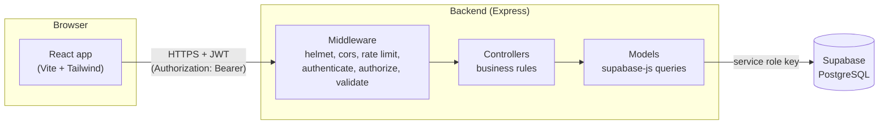
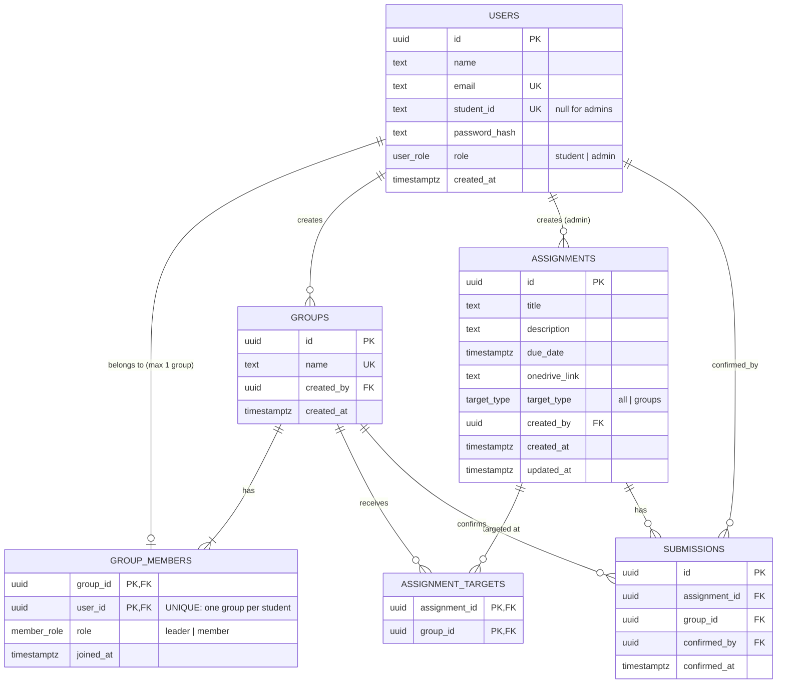

# Joineazy: Student, Group & Assignment Management System

A role-based full-stack web app where **students** form their own groups, access assignment submission links and confirm submissions, while **professors** create assignments, choose who they are for, and track every group's progress from one dashboard.

Built for the Joineazy Full Stack Intern technical task (Task 1).

| | |
|---|---|
| **Live app** | _add the Vercel URL here_ |
| **Backend API** | _add the Render URL here_ (`/api/health` should return `{"success":true,"status":"ok"}`) |
| **Demo video** | _add the video link here_ |

---

## Table of contents

1. [Features](#1-features)
2. [Tech stack](#2-tech-stack)
3. [Architecture](#3-architecture)
4. [Project structure](#4-project-structure)
5. [Database schema](#5-database-schema)
6. [Getting started](#6-getting-started)
7. [API reference](#7-api-reference)
8. [Frontend overview](#8-frontend-overview)
9. [Key design decisions](#9-key-design-decisions)
10. [Security](#10-security)
11. [Deployment](#11-deployment)
12. [Known limitations and future work](#12-known-limitations-and-future-work)

---

## 1. Features

### Student

- **Register and log in** with email and password (JWT based).
- **Create a group** and become its leader. A student can be in at most one group.
- **Add teammates** by searching for students who do not have a group yet (by name, email or student ID).
- **Remove members** (leader only) or **leave** the group. If the leader leaves, leadership passes to the member who joined first; if the last member leaves, the group is deleted.
- **View assignments** posted by professors: only the ones meant for everyone or for the student's group.
- **Open the OneDrive submission link** for each assignment.
- **Confirm a submission with a two-step verification**: "Yes, I have submitted" and then "Confirm submission". The confirmation counts for the whole group.
- **Track progress visually**: a progress bar, status badges (Pending, Submitted, Overdue) and counters on the dashboard, plus filters on the assignment list.

### Professor (admin)

- **Create, edit, view and delete assignments** (title, description, due date, OneDrive link).
- **Choose the audience**: all students, or a hand-picked set of groups.
- **Track submissions group-wise and student-wise** for every assignment: status, who confirmed and when. Students who have not formed a group yet are flagged.
- **Dashboard and analytics**: summary cards, completion per assignment, group ranking and an overall confirmed vs pending chart.
- **Groups overview**: every group with its members, leader, completion rate and overdue count.

### Platform

- Role-based access control (student and admin) enforced on the API and in the UI.
- Responsive layout (phone, tablet, desktop) with a slide-in menu on small screens.
- Friendly loading, empty and error states, plus a recovery screen when the server is unreachable.
- Client-side and server-side validation with consistent error messages.

---

## 2. Tech stack

| Layer | Technology |
|---|---|
| Frontend | React 19, Vite, Tailwind CSS 4, React Router, Axios, Recharts, react-hot-toast |
| Backend | Node.js, Express 5 |
| Database | Supabase (PostgreSQL), accessed with the `@supabase/supabase-js` client |
| Migrations | `node-pg-migrate` (JavaScript migrations) |
| Authentication | JWT (`jsonwebtoken`) with `bcrypt` password hashing |
| Validation | Zod |
| Security | Helmet, CORS allow-list, `express-rate-limit` |
| Hosting | Vercel (frontend), Render (backend), Supabase (database) |

Code style: ES modules everywhere (`import` / `export`), `async/await`, small single-purpose functions.

---

## 3. Architecture



**Request flow:** `route → middleware (rate limit, authenticate, authorize, validate) → controller → model → Supabase`.

- **Routes** map URLs to controllers and declare which middleware protects them.
- **Controllers** hold the business rules (who may do what, conflicts, edge cases) and shape the response.
- **Models** are the only place that talks to the database. There is no raw SQL in the application code.
- The browser never talks to Supabase directly. Row Level Security is enabled on every table with no policies, so only the API (using the service role key) can read or write data.

**Frontend data flow:** pages load data through a small `useFetch` hook. Results are cached per page, so revisiting a page shows the last data instantly while fresh data loads in the background. The cache is cleared on login and logout.

---

## 4. Project structure

```
joineazy_ass/
├── backend/
│   ├── database/
│   │   ├── migrations/            # node-pg-migrate JS migrations (tables, enums, constraints, RLS)
│   │   └── seed.js                # creates the admin and demo students
│   ├── src/
│   │   ├── config/                # env.js (validated env vars), supabase.js (client)
│   │   ├── routes/                # URL → middleware → controller (index.js mounts everything under /api)
│   │   ├── controllers/           # auth, group, student, assignment, submission, analytics
│   │   ├── models/                # user, group, assignment, submission (database access)
│   │   ├── validators/            # Zod schemas for request bodies, params and queries
│   │   ├── middleware/            # authenticate, authorize, validate, rateLimiter, errorHandler, notFound
│   │   ├── utils/                 # ApiError, asyncHandler, jwt, progress rules, unwrap, ttlCache
│   │   ├── app.js                 # Express app (helmet, cors, body parser, routes, error handling)
│   │   └── server.js              # starts the server, graceful shutdown
│   ├── .env.example
│   └── package.json
├── frontend/
│   ├── public/                    # favicon
│   ├── src/
│   │   ├── api/                   # Axios client + one module per API area
│   │   ├── components/
│   │   │   ├── ui/                # Button, Input, Textarea, Card, Modal, Badge, ProgressBar, Spinner, EmptyState
│   │   │   ├── layout/            # DashboardLayout, Sidebar, Navbar, AuthLayout
│   │   │   ├── shared/            # AssignmentCard, ConfirmSubmissionModal, MemberList, StatCard, ...
│   │   │   └── charts/            # CompletionBarChart, SubmissionDonut (loaded on demand)
│   │   ├── context/               # AuthContext + AuthProvider (session handling)
│   │   ├── hooks/                 # useAuth, useFetch, useForm, useDebounce, usePageTitle
│   │   ├── routes/                # AppRoutes, ProtectedRoute, RoleRoute, PublicOnlyRoute
│   │   ├── pages/                 # auth/, student/, admin/
│   │   └── utils/                 # constants, validators, date, errors, cn
│   ├── .env.example
│   ├── vercel.json                # SPA rewrite so page refreshes work
│   └── package.json
├── PLANNING.md                    # project plan and design decisions
└── README.md
```

---

## 5. Database schema



### Relationships and rules

| Rule | How it is enforced |
|---|---|
| A student belongs to at most one group | `UNIQUE (user_id)` on `group_members` |
| A group confirms an assignment only once | `UNIQUE (assignment_id, group_id)` on `submissions` |
| Group names are unique (case-insensitive in the app) | `UNIQUE (name)` on `groups` plus a case-insensitive check in the API |
| Deleting an assignment removes its targets and submissions | `ON DELETE CASCADE` |
| Deleting a group removes its memberships, targets and submissions | `ON DELETE CASCADE` |
| Which assignments a student sees | `target_type = 'all'` **or** the student's group is listed in `assignment_targets` |
| Direct database access from the browser is blocked | Row Level Security enabled on every table, with no policies |

The schema lives in `backend/database/migrations/` and is created with `npm run migrate`. Enum types: `user_role`, `member_role`, `target_type`.

---

## 6. Getting started

### Prerequisites

- Node.js **20 or newer** and npm
- A free [Supabase](https://supabase.com) project

### 1. Install dependencies

```bash
cd backend && npm install
cd ../frontend && npm install
```

### 2. Configure the backend

Copy `backend/.env.example` to `backend/.env` and fill it in:

| Variable | Required | Description |
|---|---|---|
| `SUPABASE_URL` | yes | Project URL, from Supabase → Project Settings → API (`https://<ref>.supabase.co`) |
| `SUPABASE_SERVICE_ROLE_KEY` | yes | The **service_role** key from the same page. Secret: server only, never in the frontend |
| `JWT_SECRET` | yes | Long random string used to sign tokens (at least 32 characters in production) |
| `DATABASE_URL` | for migrations | Supabase → Connect → **Session pooler** connection string. Used only by `npm run migrate`. URL-encode special characters in the password |
| `PORT` | no | Defaults to `5000` |
| `JWT_EXPIRES_IN` | no | Defaults to `1d` |
| `CLIENT_URL` | no locally | Allowed frontend origin(s) for CORS, comma-separated. Defaults to `http://localhost:5173` |
| `GROUP_MAX_SIZE` | no | Maximum members per group. Defaults to `10` |

Generate a secret with: `node -e "console.log(require('crypto').randomBytes(48).toString('hex'))"`

### 3. Create the tables and demo data

```bash
cd backend
npm run migrate      # creates tables, enums, constraints and Row Level Security
npm run seed         # creates the professor account and six demo students (safe to re-run)
```

### 4. Configure the frontend

Copy `frontend/.env.example` to `frontend/.env.local` if your API is not on the default address:

```
VITE_API_URL=http://localhost:5000/api
```

### 5. Run both apps

```bash
# terminal 1
cd backend && npm run dev        # http://localhost:5000

# terminal 2
cd frontend && npm run dev       # http://localhost:5173
```

Open **http://localhost:5173**. Restart the frontend after changing `.env.local`.

### Demo accounts (created by `npm run seed`)

| Role | Email | Password |
|---|---|---|
| Professor | `admin@joineazy.com` | `Admin@123` |
| Student | `aarav@student.com` | `Student@123` |

Other students: `diya`, `rohan`, `ananya`, `kabir`, `meera` (all `@student.com`, same password). Override the passwords with `SEED_ADMIN_PASSWORD` and `SEED_STUDENT_PASSWORD` before seeding. Public sign-up always creates **students**; professor accounts only come from the seed script.

### Scripts

| Where | Command | What it does |
|---|---|---|
| backend | `npm run dev` | Start with auto-reload (nodemon) |
| backend | `npm start` | Start for production |
| backend | `npm run migrate` | Apply new migrations |
| backend | `npm run migrate:down` | Undo the last migration |
| backend | `npm run migrate:create -- <name>` | Create a new migration file |
| backend | `npm run seed` | Create admin and demo students |
| frontend | `npm run dev` | Start the Vite dev server |
| frontend | `npm run build` | Production build into `dist/` |
| frontend | `npm run lint` | Lint with oxlint |

---

## 7. API reference

Base URL: `http://localhost:5000/api` (locally) or `https://<your-render-service>.onrender.com/api`.

### Conventions

**Authentication.** Log in or register to get a JWT, then send it on every protected request:

```
Authorization: Bearer <token>
```

The token carries the user's `id` and `role` and expires after one day. On every request the server also checks that the user still exists and uses their current role.

**Access levels used below:** 🔓 public · 🔑 any logged-in user · 🎓 student only · 🛡️ admin only.

**Success responses** always include `"success": true` plus the data. **Error responses** share one shape:

```json
{
  "success": false,
  "message": "Validation failed",
  "errors": [{ "field": "email", "message": "Enter a valid email" }]
}
```

`errors` is only present for validation failures.

| Status | Meaning |
|---|---|
| `200` / `201` | Success / created |
| `400` | Validation failed, or the request is not allowed in the current state |
| `401` | Missing, invalid or expired token; wrong credentials |
| `403` | Logged in but the role is not allowed |
| `404` | Not found (also used when a student asks for an assignment that is not meant for their group) |
| `409` | Conflict: duplicate email, name taken, already in a group, already confirmed, group full |
| `413` | Request body larger than 10 KB |
| `429` | Too many requests (rate limit) |
| `500` | Unexpected server error |

**Rate limits** (per IP, 15-minute window): 50 requests on `/auth/register` and `/auth/login`, 500 on the rest of the API.

**Object shapes**

```jsonc
// user
{ "id": "uuid", "name": "Aarav Sharma", "email": "aarav@student.com",
  "studentId": "STU001", "role": "student", "createdAt": "2026-11-23T10:00:00Z" }

// group
{ "id": "uuid", "name": "Alpha Squad", "createdBy": "uuid", "createdAt": "…",
  "members": [
    { "id": "uuid", "name": "Aarav Sharma", "email": "…", "studentId": "STU001",
      "role": "leader", "joinedAt": "…" } ] }

// assignment (admin view)
{ "id": "uuid", "title": "Database Design Report", "description": "…",
  "dueDate": "2026-12-05T05:00:00Z", "onedriveLink": "https://1drv.ms/…",
  "targetType": "groups", "createdAt": "…", "updatedAt": "…",
  "targets": [{ "id": "uuid", "name": "Alpha Squad" }] }

// assignment (student view): no "targets", plus status and submission
{ …same fields…, "status": "submitted",   // "pending" | "submitted" | "overdue"
  "submission": { "confirmedAt": "…", "confirmedBy": { "id": "uuid", "name": "Aarav Sharma" } } }
```

### Overview of all endpoints

| Method | Endpoint | Access | Purpose |
|---|---|---|---|
| GET | `/health` | 🔓 | Health check |
| POST | `/auth/register` | 🔓 | Student sign-up |
| POST | `/auth/login` | 🔓 | Log in |
| GET | `/auth/me` | 🔑 | Current user |
| POST | `/groups` | 🎓 | Create a group |
| GET | `/groups/me` | 🎓 | My group and its members |
| POST | `/groups/:id/members` | 🎓 leader | Add a member |
| DELETE | `/groups/:id/members/:userId` | 🎓 leader | Remove a member |
| POST | `/groups/:id/leave` | 🎓 | Leave a group |
| GET | `/groups` | 🛡️ | All groups with members |
| GET | `/students/search` | 🎓 | Find students without a group |
| GET | `/assignments` | 🔑 | List assignments (role-aware) |
| GET | `/assignments/:id` | 🔑 | One assignment (role-aware) |
| POST | `/assignments` | 🛡️ | Create an assignment |
| PUT | `/assignments/:id` | 🛡️ | Edit an assignment |
| DELETE | `/assignments/:id` | 🛡️ | Delete an assignment |
| POST | `/assignments/:id/confirm` | 🎓 | Confirm submission for my group |
| GET | `/assignments/:id/submissions` | 🛡️ | Group-wise and student-wise status |
| GET | `/analytics/overview` | 🛡️ | Totals and overall completion |
| GET | `/analytics/assignments` | 🛡️ | Completion per assignment |
| GET | `/analytics/groups` | 🛡️ | Completion per group |
| GET | `/analytics/me` | 🎓 | My group's progress |

---

### 7.1 Health

#### `GET /health` 🔓

```json
{ "success": true, "status": "ok" }
```

---

### 7.2 Auth

#### `POST /auth/register` 🔓

Creates a **student** account and logs them in. Professor accounts cannot be created here.

**Body**

| Field | Rules |
|---|---|
| `name` | 2–60 characters; extra spaces are collapsed |
| `email` | Valid email, up to 254 characters; stored in lowercase |
| `studentId` | 3–20 characters: letters, numbers, `-` or `_`; stored in uppercase (`stu001` = `STU001`) |
| `password` | 8–72 characters with at least one letter and one number |

**Response `201`**

```json
{ "success": true, "token": "<jwt>", "user": { "id": "…", "name": "…", "email": "…", "studentId": "STU900", "role": "student", "createdAt": "…" } }
```

**Errors:** `400` validation · `409` `Email is already registered` / `Student ID is already registered`

#### `POST /auth/login` 🔓

**Body:** `{ "email": "aarav@student.com", "password": "Student@123" }`

**Response `200`:** same shape as register (`token` and `user`).

**Errors:** `400` validation · `401` `Invalid email or password` (the same message whether the email or the password is wrong).

#### `GET /auth/me` 🔑

Returns the logged-in user. The frontend calls this on page load to restore the session.

**Response `200`:** `{ "success": true, "user": { … } }`

**Errors:** `401` missing, invalid or expired token, or the account no longer exists.

---

### 7.3 Groups and students

#### `POST /groups` 🎓

Creates a group. The caller becomes its **leader**.

**Body:** `{ "name": "Alpha Squad" }`: 3–40 characters using letters, numbers, spaces and `. _ - & '`.

**Response `201`:** `{ "success": true, "group": { … } }`

**Errors:** `400` validation · `409` `You are already in a group` / `A group with this name already exists` (names are compared case-insensitively).

#### `GET /groups/me` 🎓

**Response `200`:** `{ "success": true, "group": { … } }`. `group` is `null` when the student has not joined a group.

#### `POST /groups/:id/members` 🎓 (leader only)

Adds a student to the group.

**Body:** `{ "identifier": "diya@student.com" }`. Either an email or a student ID (`STU002`, case-insensitive).

**Response `201`:** `{ "success": true, "group": { … } }` (the updated group).

**Errors**

| Status | When |
|---|---|
| `400` | Invalid group id or identifier |
| `403` | The caller is not the group's leader |
| `404` | Group not found, or no student matches the identifier |
| `409` | The group is full (default max 10) · the student is already in your group · the student is in another group |

#### `DELETE /groups/:id/members/:userId` 🎓 (leader only)

Removes a member.

**Response `200`:** `{ "success": true, "group": { … } }`

**Errors:** `400` the leader tried to remove themselves (use *leave*) · `403` not the leader · `404` group not found or that student is not in this group.

#### `POST /groups/:id/leave` 🎓

Leaves the group.

- If the **leader** leaves and others remain, leadership passes to the member who joined first.
- If the **last member** leaves, the group is deleted.

**Response `200`:** `{ "success": true, "message": "You left the group" }`

**Errors:** `404` the caller is not a member of this group.

#### `GET /groups` 🛡️

All groups with their members, newest first.

**Response `200`:** `{ "success": true, "groups": [ { … } ] }`

#### `GET /students/search?q=<text>` 🎓

Students who are **not in any group**, for the "add teammate" box. Matches name, email or student ID. Returns at most 20, sorted by name.

| Query | Rules |
|---|---|
| `q` | Optional, up to 50 characters. Characters that could act as search wildcards are stripped |

**Response `200`:** `{ "success": true, "students": [ { "id": "…", "name": "…", "email": "…", "studentId": "…", "role": "student", "createdAt": "…" } ] }`

---

### 7.4 Assignments

#### `GET /assignments` 🔑

Role-aware list, ordered by due date.

- **Admin:** every assignment, each with `targets`.
- **Student:** only assignments for everyone or for the student's group. Each item has `status` and `submission` and no `targets`. A student without a group only sees "for everyone" assignments.

**Response `200`:** `{ "success": true, "assignments": [ … ] }`

#### `GET /assignments/:id` 🔑

One assignment, in the same role-aware shape.

**Errors:** `400` invalid id · `404` not found. A student asking for an assignment that is not meant for their group also gets `404`, so they cannot discover assignments for other groups.

#### `POST /assignments` 🛡️

**Body**

| Field | Rules |
|---|---|
| `title` | 3–120 characters |
| `description` | Optional, up to 2000 characters |
| `dueDate` | ISO 8601 date-time with offset (for example `2026-12-05T10:30:00.000Z`). Must be in the future and at most 5 years ahead |
| `onedriveLink` | A valid `http(s)` URL, up to 2048 characters |
| `targetType` | `"all"` (default) or `"groups"` |
| `groupIds` | Array of group ids. Required (at least one) when `targetType` is `"groups"`, up to 100, every group must exist. Ignored when `"all"` |

```json
{
  "title": "Database Design Report",
  "description": "Design the ER diagram and normalise to 3NF.",
  "dueDate": "2026-12-05T10:30:00.000Z",
  "onedriveLink": "https://1drv.ms/f/s!example",
  "targetType": "groups",
  "groupIds": ["<group-uuid>"]
}
```

**Response `201`:** `{ "success": true, "assignment": { … } }`

**Errors:** `400` validation, or a selected group does not exist · `403` not an admin.

#### `PUT /assignments/:id` 🛡️

Same body as create, except the due date **may be in the past** (so an old assignment can still be edited). Targets are updated by difference: new groups are added first and removed groups deleted last, so a failed edit never wipes the audience.

**Response `200`:** `{ "success": true, "assignment": { … } }`

**Errors:** `400` · `403` · `404`.

#### `DELETE /assignments/:id` 🛡️

Deletes the assignment together with its targets and every submission confirmation.

**Response `200`:** `{ "success": true, "message": "Assignment deleted" }`

**Errors:** `403` · `404`.

---

### 7.5 Submissions

#### `POST /assignments/:id/confirm` 🎓

Confirms the submission for the student's **whole group**. This is the final step of the two-step verification in the UI (the first step, "Yes, I have submitted", is a question in the frontend).

**Body:** `{ "confirm": true }`. Anything else is rejected, so a request cannot confirm by accident.

**Response `201`**

```json
{
  "success": true,
  "status": "submitted",
  "submission": {
    "assignmentId": "uuid",
    "groupId": "uuid",
    "confirmedAt": "2026-11-23T11:00:00Z",
    "confirmedBy": { "id": "uuid", "name": "Aarav Sharma" }
  }
}
```

**Errors**

| Status | When |
|---|---|
| `400` | `confirm` is not `true`, or the student has no group (`Create or join a group before confirming a submission`) |
| `403` | The caller is an admin |
| `404` | Assignment not found, or not meant for the student's group |
| `409` | `Your group has already confirmed this assignment` (a teammate got there first, or two confirms arrived together) |

#### `GET /assignments/:id/submissions` 🛡️

Group-wise and student-wise tracking for one assignment.

**Response `200`**

```jsonc
{
  "success": true,
  "assignment": { … },
  "summary": { "targetedGroups": 3, "submittedGroups": 2, "pendingGroups": 1, "completionRate": 67 },
  "groups": [
    { "id": "uuid", "name": "Alpha Squad", "memberCount": 2,
      "status": "submitted",                       // "submitted" | "pending" | "overdue"
      "confirmedAt": "…", "confirmedBy": { "id": "uuid", "name": "Aarav Sharma" },
      "members": [ … ] }
  ],
  "students": [
    { "id": "uuid", "name": "Diya Patel", "email": "…", "studentId": "STU002",
      "group": { "id": "uuid", "name": "Alpha Squad" },
      "status": "submitted",                       // adds "no_group"
      "confirmedByThisStudent": false }            // true only for the student who clicked confirm
  ]
}
```

`students` lists everyone in the targeted groups and shows their group's status. For assignments sent to **all students**, students who have not formed a group are included with `status: "no_group"`.

**Errors:** `400` invalid id · `403` · `404`.

---

### 7.6 Analytics

Completion rates are rounded percentages (0–100). "Expected" submissions means every targeted group for every assignment.

#### `GET /analytics/overview` 🛡️

```json
{
  "success": true,
  "overview": {
    "totalStudents": 6, "studentsInGroups": 5, "studentsWithoutGroup": 1,
    "totalGroups": 3, "totalAssignments": 3,
    "expectedSubmissions": 8, "confirmedSubmissions": 3, "pendingSubmissions": 5,
    "completionRate": 38
  }
}
```

#### `GET /analytics/assignments` 🛡️

One entry per assignment, ordered by due date.

```json
{ "success": true, "assignments": [
  { "id": "uuid", "title": "REST API Project", "dueDate": "…",
    "targetedGroups": 2, "submittedGroups": 1, "pendingGroups": 1, "completionRate": 50 } ] }
```

#### `GET /analytics/groups` 🛡️

One entry per group, ranked by completion rate (best first).

```json
{ "success": true, "groups": [
  { "id": "uuid", "name": "Alpha Squad", "memberCount": 2,
    "assigned": 3, "submitted": 2, "pending": 1, "overdue": 1, "completionRate": 67 } ] }
```

#### `GET /analytics/me` 🎓

The logged-in student's group progress. For a student without a group, `group` is `null` and every count is `0`.

```json
{ "success": true, "progress": {
  "group": { "id": "uuid", "name": "Alpha Squad" },
  "total": 3, "submitted": 2, "pending": 0, "overdue": 1, "completionRate": 67 } }
```

An assignment counts as **overdue** when its due date has passed and the group has not confirmed it.

---

## 8. Frontend overview

### Routes

| Path | Who | Page |
|---|---|---|
| `/login`, `/register` | Logged-out users | Login and student sign-up. The login page has one-click demo accounts |
| `/student` | Student | Dashboard: group progress bar, counters, upcoming deadlines |
| `/student/assignments` | Student | Assignment cards, filters, OneDrive link, two-step confirmation |
| `/student/group` | Student | Create a group, search and add teammates, remove members, leave |
| `/admin` | Admin | Dashboard: summary cards, completion chart, needs-attention list, top groups |
| `/admin/assignments` | Admin | All assignments with progress; track, edit, delete |
| `/admin/assignments/new` | Admin | Create an assignment (audience: all students or selected groups) |
| `/admin/assignments/:id` | Admin | Tracking: group-wise and student-wise tables |
| `/admin/assignments/:id/edit` | Admin | Edit an assignment |
| `/admin/groups` | Admin | Every group with members, completion and overdue badge |
| `/admin/analytics` | Admin | Donut and bar charts |
| `/` | Everyone | Redirects to the user's dashboard, or to `/login` |

Logged-out users are redirected to `/login`; a student opening an admin page (or the reverse) is sent back to their own dashboard.

### Session handling

- The JWT is kept in `localStorage` and attached to every request by an Axios interceptor.
- If the API answers `401` on a normal request, the user is logged out with a "session expired" message.
- If the server cannot be reached while restoring a session (offline, or a free-tier server waking up), the user stays signed in and sees a **Try again** screen instead of being logged out.

---

## 9. Key design decisions

| Decision | Why |
|---|---|
| **Supabase through the `supabase-js` client**, no raw SQL in app code | Readable query-builder code. The service role key stays on the server and Row Level Security blocks any direct access from the browser |
| **Schema created by code-based migrations** (`node-pg-migrate`) | `supabase-js` cannot create tables. Migrations are versioned, repeatable and tracked in a `pgmigrations` table. `DATABASE_URL` is used for this alone |
| **Custom JWT auth** instead of Supabase Auth | The task asks for JWT roles; the token carries `{ id, role }` and the server controls the whole flow |
| **Users are re-checked on every request** (cached for 15 seconds) | A deleted account or changed role takes effect quickly, without a database trip per request |
| **Sign-up creates students only** | Nobody can make themselves a professor. Admin accounts come from the seed script |
| **One group per student** | Makes progress tracking unambiguous. Enforced by a unique constraint, not just code |
| **Confirmation is per group per assignment**, and records who clicked | Group work is uploaded once. Student-wise tracking still shows who confirmed |
| **Two-step confirmation** | The UI asks twice, and the API only accepts an explicit `confirm: true` |
| **Student-facing 404 for hidden assignments** | A student cannot learn that an assignment exists for another group |
| **Layered backend** (routes, controllers, models) | Each layer has one job; all database access sits in the models |
| **Frontend page cache and lazy-loaded charts** | Revisits feel instant and the charting library only downloads when needed |
| **No transactions in `supabase-js`** | Multi-step writes (create a group and its leader, an assignment and its targets) insert in order and undo the first step if a later one fails |

---

## 10. Security

- **Passwords** are hashed with bcrypt (10 rounds) and never returned by any endpoint. A login for an unknown email takes as long as a wrong password and gives the same message.
- **JWT** is signed with `JWT_SECRET` (32+ characters enforced in production), expires after one day, and forged or `alg=none` tokens are rejected.
- **Role checks** run on the server for every protected route (`authenticate` then `authorize`), and again in the UI for navigation.
- **Validation** with Zod on every body, parameter and query string; ids must be UUIDs; search text is sanitised before it reaches a database filter.
- **Helmet** sets security headers; **CORS** only allows the origins in `CLIENT_URL`; request bodies are limited to 10 KB.
- **Rate limiting** on login and register and on the API overall (see the API conventions above).
- **Row Level Security** is enabled on every table with no policies, so the public Supabase key cannot read or write data.
- **Errors** use one shape and never expose stack traces or database internals in production.
- Secrets live in `.env` files that are git-ignored; only `.env.example` files are committed.

---

## 11. Deployment

The app is deployed as three parts: **Supabase** (database), **Render** (backend) and **Vercel** (frontend).

### 1. Database (Supabase)

Create a project, then run `npm run migrate` and `npm run seed` once from your machine with `backend/.env` pointing at that project.

### 2. Backend (Render, Web Service)

| Setting | Value |
|---|---|
| Root directory | `backend` |
| Build command | `npm install` |
| Start command | `npm start` |
| Health check path | `/api/health` |

Environment variables:

| Variable | Value |
|---|---|
| `NODE_ENV` | `production` |
| `SUPABASE_URL` | Your project URL |
| `SUPABASE_SERVICE_ROLE_KEY` | Your service_role key |
| `JWT_SECRET` | A random string of at least 32 characters |
| `CLIENT_URL` | The deployed frontend URL, for example `https://your-app.vercel.app` (several origins can be comma-separated) |

`DATABASE_URL` is **not** needed on the server; it is only for running migrations. Render sets `PORT` itself.

### 3. Frontend (Vercel)

| Setting | Value |
|---|---|
| Root directory | `frontend` |
| Framework preset | Vite |
| Build command | `npm run build` |
| Output directory | `dist` |

Environment variable: `VITE_API_URL` = `https://<your-render-service>.onrender.com/api`. Vite bakes this in when the app is **built**, so redeploy after changing it. `frontend/vercel.json` rewrites every path to `index.html` so refreshing a page such as `/admin/groups` works.

### Notes

- Free Render services go to sleep when idle, so the first request after a pause can take up to a minute. The frontend allows for this with a 45-second request timeout and a "server may be waking up" message.
- For the lowest latency, create the Render service in the same region as the Supabase project.

---

## 12. Known limitations and future work

- **No automated test suite yet.** The API and UI were verified with scripted end-to-end checks and manual testing; adding Jest and Supertest tests for auth and the confirmation flow is the next step.
- **Lists are not paginated.** Fine for a class-sized dataset; Supabase also returns at most 1000 rows per query by default.
- **User cache window.** Because users are cached for 15 seconds, an account deleted directly in the database can keep working for up to 15 seconds.
- **No invitations.** The group leader adds students directly instead of sending an invite that the student accepts.
- **Token storage.** The JWT is kept in `localStorage` (simple across separate Vercel and Render domains). An HttpOnly cookie setup would be more resistant to XSS.
- Possible extras: email notifications for new assignments, CSV export of submission status, search and sorting on admin tables.
